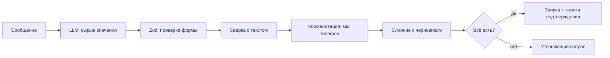

# Бот разбора заявок на окна / двери


Telegram-бот, который превращает заявку покупателя в свободной форме в аккуратную структуру: тип изделия, размеры в миллиметрах, количество и контакты. Если данных не хватает, бот уточняет. Если сообщение не заявка, бот прямо об этом говорит.

**Попробовать:** [avansumAppBot](https://web.telegram.org/k/#@avansumAppBot)

---

## Как это работает

> Нейросеть только читает текст. Решения принимает код.

Языковая модель (Gemini или Groq, выбирается переменной окружения) извлекает из сообщения сырые значения, как их написал покупатель («70», «см», «одна», «80290000022»), и возвращает строгий JSON по схеме. Дальше работает приложение. Каждое значение сверяется с исходным текстом, и всё, чего там нет, отбрасывается. Размеры переводятся в миллиметры, телефон проверяется и приводится к маске. Решение, полная ли заявка или нужно уточнение, принимает бизнес-логика, а не модель.



## Примеры

**Полная заявка**

> Здравствуйте! Нужно окно 1000х1200, 2 шт. Павел, +375 29 000-00-21

```
Тип изделия: Окно;
Размеры, ШхВ: 1000х1200мм – 2шт;

ФИО покупателя: Павел;
Тел.: +375 (29) 000-00-21;
Email: не указано
```

**Сантиметры, телефон без кода страны, имя со строчной буквы**

> дверь балконная 70 на 210 см одна, тел 80290000022 анна

```
Тип изделия: Дверь балконная;
Размеры, ШхВ: 700х2100мм – 1шт;

ФИО покупателя: Анна;
Тел.: +375 (29) 000-00-22;
Email: не указано
```

**Не заявка**

> Сколько стоит остеклить балкон?

```
Это вопрос, а не заявка — стоимость и детали рассчитает менеджер.
Чтобы оформить заявку, напишите тип изделия (окно, дверь, стеклопакет…), размеры, количество и ваши контакты.
Например: «Окно 1000х1200, 2 шт. Павел, +375 29 000-00-21».
```

**Диалог с уточнениями**

```
— Нужно окно 1000 на 1200
— Сколько штук нужно (окно)?
— Два
— Как к вам обращаться? Оставьте, пожалуйста, телефон или email для связи.
— Павел, +375 29 000-00-21
— Заявка разобрана: Окно 1000х1200мм – 2шт … [Подтвердить] [Отменить]
```

Ещё бот умеет:

- разбирать несколько изделий в одном сообщении, каждое отдельной строкой;
- понимать размеры в разговорной форме («метр на полтора»);
- принимать исправления на любом шаге («ширина 900»);
- отменять заявку командой `/cancel` или словами «отмена», «не надо».

## Как бот не выдумывает данные

Это главное требование задания, поэтому защита сделана в несколько слоёв:

| Слой | Что делает |
| --- | --- |
| Промпт | Запрещает додумывать: если значения нет в тексте, модель ставит `null`, единицы не переводит, количество 1 по умолчанию не подставляет |
| Structured output + Zod | Модель отвечает строго по JSON Schema, ответ дополнительно проверяется Zod-схемой. При невалидном ответе делается один повтор |
| Сверка с текстом | Каждое число, имя, тип изделия, телефон и email должны находиться в исходном сообщении. Если модель вернула что-то, чего там нет, значение отбрасывается, и бот задаёт вопрос |
| Нормализация | Неоднозначные размеры («150х2000») и некорректные телефоны («+375 29 123») не исправляются молча: бот сообщает о проблеме и просит уточнить |

Например, если на сообщение «окно 1000х1200» модель вернёт `quantity: 1`, значение отбросится, потому что единицы в тексте нет, и бот спросит, сколько штук нужно.

## Архитектура

```
src/
├── bot/                    Telegram: команды, сообщения, кнопки, форматирование ответа
├── ai/                     LLM: интерфейс провайдера, Gemini и OpenAI-совместимый, промпт, валидация
├── schemas/                Zod-схемы: ответ модели и доменная модель заявки
├── services/
│   ├── request.service     бизнес-логика: слияние, полнота, следующий шаг
│   ├── grounding.service   сверка извлечённых значений с текстом
│   ├── normalization       единицы → мм, количество, имя, email
│   ├── phone.service       проверка и маска телефона
│   └── conversation        незавершённые заявки (in-memory, TTL 30 мин)
└── config/                 проверка переменных окружения
```

**Решения, которые стоит отметить**

- **Две схемы данных.** Ответ модели (сырые значения) и доменная заявка (миллиметры, отформатированный телефон) описаны отдельно. TypeScript-типы выводятся из Zod-схем, поэтому описание каждой структуры существует в одном месте.
- **Провайдер LLM заменяем.** Бизнес-логика зависит от интерфейса `AiProvider` с одним методом. Реализаций две: Gemini и OpenAI-совместимая (Groq, Cerebras, Mistral, OpenRouter). Провайдер выбирается переменными окружения, без изменения кода.
- **Лимиты API.** При превышении квоты (429) запрос не повторяется, чтобы не тратить её вдвое, а пользователь видит отдельное сообщение «Сервис сейчас перегружен».
- **Размеры без единиц.** Число от 300 считается миллиметрами, от 30 до 299 — сантиметрами, меньше 30 — бот переспрашивает. Если ширина и высота попадают в разные диапазоны, бот тоже уточняет.
- **Телефоны.** Строгая проверка libphonenumber отклоняет тестовые номера вида `+375 29 000-00-21`, поэтому номер проверяется по длине и коду белорусского оператора или города. Вывод идёт в маске `+375 (29) 000-00-21`.
- **Обязательные поля:** тип, ширина, высота и количество для каждого изделия, плюс телефон или email. Имя желательно, но без него заявка не блокируется.
- **Без лишнего.** Нет HTTP-сервера (бот работает через long polling), нет базы данных (для MVP хватает памяти), нет DI-контейнеров.

## Стек

Node.js 24, TypeScript (strict), [grammY](https://grammy.dev), [Gemini API](https://ai.google.dev) (`@google/genai`) или [Groq](https://console.groq.com) (OpenAI-совместимый API через `fetch`), [Zod](https://zod.dev), [libphonenumber-js](https://gitlab.com/catamphetamine/libphonenumber-js), Vitest, Docker.

## Тесты

```bash
npm test        # 78 unit-тестов, без сети: модель заменена фейком
npm run eval    # 13 сценариев из задания через настоящую модель (тратит ту же квоту, что и бот)
```

Unit-тесты проверяют детерминированную часть: все сценарии из задания, диалог с уточнениями, ошибки AI, оба провайдера (с замоканным `fetch`), конфигурацию окружения, нормализацию, телефоны. Отдельная группа тестов проверяет, что выдуманные моделью значения отбрасываются. `eval` проверяет сам промпт на живой модели и печатает отчёт PASS/FAIL по каждому сценарию.

## AI-провайдер

Переменные не привязаны к конкретному вендору: провайдер выбирается `AI_PROVIDER`, а ключ и модель всегда задаются через `AI_API_KEY` и `AI_MODEL`. По умолчанию используется OpenAI-совместимый API Groq.

| Переменная | Когда нужна | По умолчанию |
| --- | --- | --- |
| `BOT_TOKEN` | всегда | — |
| `AI_PROVIDER` | — | `openai` (или `gemini`) |
| `AI_API_KEY` | всегда | — |
| `AI_MODEL` | — | `openai/gpt-oss-120b` для `openai`, `gemini-3.8-flash` для `gemini` |
| `AI_BASE_URL` | только `openai` | `https://api.groq.com/openai/v1` |
| `AI_REASONING_EFFORT` | только `openai` | не передаётся (`low` / `medium` / `high`) |

**Groq (по умолчанию).** Для `openai/gpt-oss-120b` около 1000 запросов в день, 8K токенов в минуту и 200K токенов в день (точные цифры в консоли Groq, раздел Limits), отвечает за доли секунды. У бесплатного тарифа Gemini для части моделей всего 20 запросов в день, поэтому основным провайдером выбран Groq.

1. Зарегистрируйтесь на [console.groq.com](https://console.groq.com) и создайте ключ в разделе API Keys.
2. Задайте переменные (в `.env` или в Railway → Variables):

```env
AI_PROVIDER=openai
AI_API_KEY=gsk_...
AI_REASONING_EFFORT=low
```

`AI_REASONING_EFFORT=low` заметно экономит токены у reasoning-модели gpt-oss: для извлечения данных глубокие рассуждения не нужны. При старте в логах должна появиться строка `Starting bot (provider: openai, model: openai/gpt-oss-120b)`.

Другой OpenAI-совместимый провайдер подключается так же, сменой `AI_BASE_URL`, `AI_API_KEY` и `AI_MODEL`. Модель должна поддерживать `response_format: json_schema` в strict-режиме.

**Вернуться на Gemini** можно без изменения кода: `AI_PROVIDER=gemini`, ключ из [Google AI Studio](https://aistudio.google.com/apikey) в `AI_API_KEY` и при необходимости модель в `AI_MODEL`.

## Локальный запуск

```bash
npm install
cp .env.example .env    # BOT_TOKEN и ключ выбранного AI-провайдера
npm run dev
```

Docker:

```bash
docker build -t windows-bot . && docker run --env-file .env windows-bot
```
